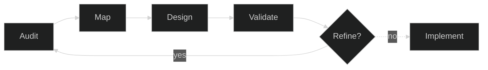

---
## Our process starts when you make the call

**AUDIT** → Identify who is present, where friction lives, and how difficulty is distributed.

**MAP** → Reveal hidden operational patterns, boundary restrictions, and unactivated potential.

**DESIGN** → Build adaptive responses, multi-participant networks, and format-aware structures.

**VALIDATE** → Test against multiple analytical frames to expose blind spots and refine outcomes.